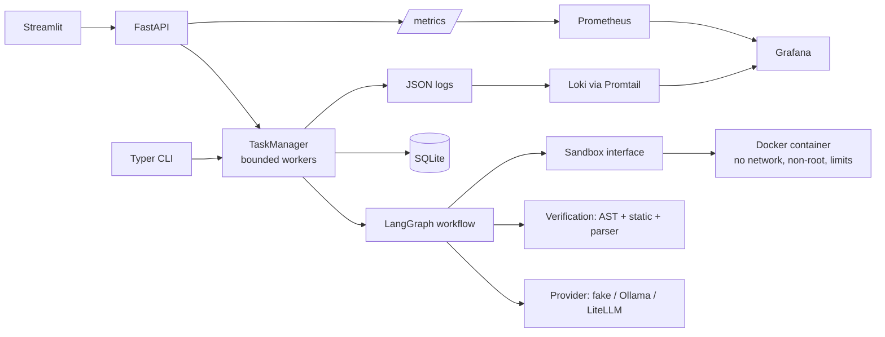

# Safe-Loop

> LLMs propose solutions. Trusted software enforces policies. Execution evidence determines outcomes.

Safe-Loop generates Python code with an LLM, validates it deterministically, runs acceptance tests in an
isolated Docker sandbox, repairs within hard budgets, and emits an evidence-based final report. It does
**not** guarantee correctness or complete security, and it is not validated for safety-critical use.

## Verification status (read this first)

| Area | Status in the authoring environment |
|---|---|
| Domain, policies, workflow, verification, persistence, API, CLI, metrics, logging | Implemented; **77 automated tests pass**, `ruff` and `mypy` clean |
| Streamlit UI (9 pages) | Implemented; smoke-tested with Streamlit `AppTest` against a live in-process API |
| Real server boot with no Docker | Verified: task ends `SANDBOX_ERROR` (fail closed), metrics emitted |
| **Docker sandbox isolation** | Written, **never run against a Docker daemon**. 6 real-isolation tests exist (`pytest -m docker`) and were **skipped** here |
| Docker Compose stack, Prometheus, Grafana, Loki, Promtail | Configs written; YAML/JSON syntax and metric-name references are tested; **never started**, alerts never fired |
| Rate limiting, retention purge, OpenTelemetry tracing | Implemented and unit/integration-tested (tracing with an in-memory exporter; **no live OTLP backend tested**) |
| Ollama / LiteLLM providers | Tested against mocked HTTP / an injected module only; **no live model call** |
| Benchmark harness | Tested with scripted doubles (validates arithmetic only). **Model results: Not yet measured** |
| Workflow tests | Use `ScriptedSandbox` (a test double; it does not execute code) |

## All commands (copy/paste)

```bash
# 0. Prerequisites: Python 3.11+, Docker (daemon running), optionally Ollama (https://ollama.com)
unzip safeloop.zip && cd safeloop

# 1. EVERYTHING in one go (venv, lint, types, tests, sandbox image, real isolation tests, Compose stack)
./scripts/setup_and_run.sh all

# ...or step by step:
./scripts/setup_and_run.sh test      # no Docker needed: venv + ruff + mypy + 77 tests
./scripts/setup_and_run.sh docker    # build sandbox image + run the 6 REAL isolation tests
ollama pull qwen2.5-coder:7b         # local model (skip if using LiteLLM)
./scripts/setup_and_run.sh up        # creates .env with random secrets, starts the stack

# 2. Submit a real task through the stack and print the final report
./scripts/smoke_stack.sh

# 3. Use it
open http://127.0.0.1:8501           # Streamlit UI
open http://127.0.0.1:3000           # Grafana (admin / password from .env)
source .venv/bin/activate
safeloop doctor                      # DB + sandbox check (run with .env exported)
safeloop benchmark --provider ollama --repeats 3   # real benchmark (A vs B vs Safe-Loop)

# 4. Stop
docker compose down                  # add -v to delete volumes
```

Without Compose (local dev): `source .venv/bin/activate && export SAFELOOP_API_TOKEN=dev && safeloop serve`
then in another terminal `SAFELOOP_API_TOKEN=dev streamlit run src/safeloop/ui/app.py`.
Optional tracing: `pip install -e ".[otel]"` and set `SAFELOOP_OTLP_ENDPOINT=http://<collector>:4318/v1/traces`.

## Architecture



Boundaries: the core engine imports neither FastAPI nor Streamlit; providers and sandboxes are replaceable
interfaces; metrics wrap the provider/sandbox as decorators and never influence outcomes; no model output can
override a deterministic policy. See `docs/architecture.md`.

## Quick start (local, no Docker, no paid API)

```bash
python3 -m venv .venv && source .venv/bin/activate
pip install -e ".[dev,docker,ui]"
pytest -q            # 77 pass, 6 docker tests skip without a daemon
```

## Run the real stack

```bash
cp .env.example .env              # set SAFELOOP_API_TOKEN, GRAFANA_ADMIN_PASSWORD, DOCKER_GID
docker build -f Dockerfile.sandbox -t safeloop-sandbox:1 .
pytest -m docker -v               # REAL isolation tests (network blocked, read-only FS, timeout, OOM, cleanup)
ollama pull qwen2.5-coder:7b      # or set SAFELOOP_LITELLM_MODEL (+ provider key) for hosted models
docker compose --profile build build sandbox-image && docker compose up -d --build
```

UI <http://127.0.0.1:8501> · API docs <http://127.0.0.1:8000/docs> · Prometheus :9090 · Grafana :3000
(all bound to localhost). Without Compose: `safeloop serve` and `streamlit run src/safeloop/ui/app.py`.

### API example

```bash
curl -X POST localhost:8000/api/v1/tasks -H "Authorization: Bearer $SAFELOOP_API_TOKEN" \
  -H 'Content-Type: application/json' -d '{
  "user_request": "Implement add(a, b) returning the sum",
  "test_strategy": "from solution import add\ndef test_a():\n    assert add(1,2)==3\n",
  "maximum_attempts": 3, "maximum_cost": 0.5, "timeout_seconds": 120}'
curl localhost:8000/api/v1/tasks/<id>/report -H "Authorization: Bearer $SAFELOOP_API_TOKEN"
curl -N localhost:8000/api/v1/tasks/<id>/events -H "Authorization: Bearer $SAFELOOP_API_TOKEN"   # SSE
```

Endpoints: `GET /api/v1/health`, `POST|GET /api/v1/tasks`, `GET /api/v1/tasks/{id}`, `POST .../cancel`,
`GET .../attempts[?include_code=true]`, `GET .../report`, `GET .../events`, `GET /api/v1/stats`, `GET /metrics`.
Auth: bearer token when `SAFELOOP_API_TOKEN` is set (`/health` and `/metrics` stay open for probes/scraping).
**With no token the API is unauthenticated: keep it on localhost. No rate limiting yet.**

### CLI

```bash
safeloop doctor                                   # DB + sandbox availability
safeloop run --request "..." --tests-file t.py --model ollama
safeloop list | safeloop report <id>
safeloop benchmark --provider ollama --repeats 3  # refuses to run without a real sandbox
```

## Benchmarks

Fixed v1.0.0 suite of 8 small Python tasks (basic, edge cases, interface, bug repair). Configurations:
A direct generation (no static gate, no repair), B generate + deterministic verification (no repair), C Safe-Loop.
Reports are written to `src/safeloop/benchmarks/reports/` by `safeloop benchmark`. **No results are committed:
Not yet measured.** Definitions and denominators: `docs/benchmark-methodology.md`.

## Troubleshooting

- `SANDBOX_ERROR` / health 503: Docker daemon unreachable or image missing (`docker build -f Dockerfile.sandbox ...`).
  This is deliberate: Safe-Loop never falls back to local execution.
- Compose API cannot reach Docker: set `DOCKER_GID` to your docker group id.
- Provider errors: check `SAFELOOP_OLLAMA_URL`; from a container use `host.docker.internal`.
- Local inference needs roughly 8 GB RAM for a 7B quantised model (GPU optional but much faster); tests do not need it.

## Known limitations / roadmap

Python only; no auth beyond a shared token; in-memory single-process rate limiting; no migrations tool (schema is `create_all`; add Alembic before
changing schema); SQLite only (SQLAlchemy keeps PostgreSQL open); Docker shares the host kernel (use VMs/gVisor/Kata for hostile
workloads); tracing is optional and untested against a live backend (Tempo not bundled); routing is preference + default order only; single-agent (no multi-agent
design without measured benefit).
