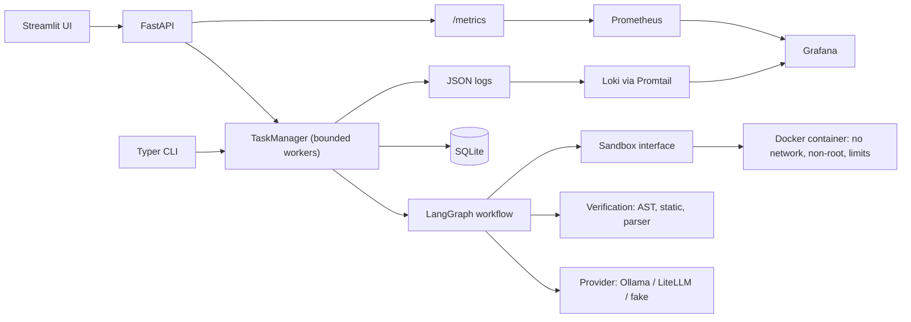
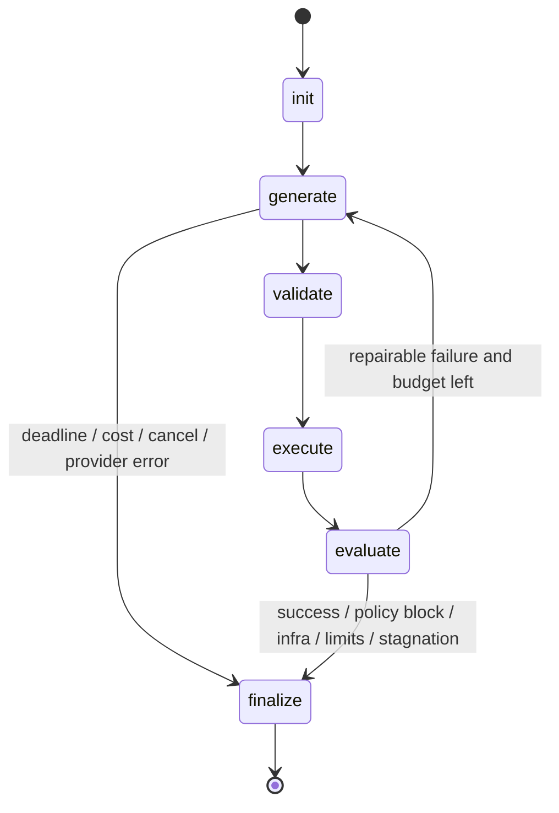

# Safe-Loop

**Evidence-driven code generation: LLMs propose, trusted software enforces, execution evidence decides.**


Safe-Loop generates Python code with an LLM, validates it with deterministic checks, runs acceptance tests inside an
isolated Docker sandbox, repairs failures within hard budgets, and produces an evidence-based final report with
full metrics, logs and an operational UI.

> Safe-Loop does **not** guarantee correctness or complete security, and it is not validated for safety-critical use.
> Passing tests is evidence, not proof.

---

## Table of contents

1. [Why Safe-Loop](#why-safe-loop)
2. [Verification status](#verification-status)
3. [Architecture](#architecture)
4. [Requirements](#requirements)
5. [Installation](#installation)
6. [Quick start](#quick-start)
7. [Using Ollama](#using-ollama)
8. [Usage](#usage)
9. [Configuration](#configuration)
10. [Testing](#testing)
11. [Observability](#observability)
12. [Benchmarking](#benchmarking)
13. [Security](#security)
14. [Troubleshooting](#troubleshooting)
15. [Project layout](#project-layout)
16. [Roadmap and limitations](#roadmap-and-limitations)
17. [Contributing and license](#contributing-and-license)

---

## Why Safe-Loop

LLM-generated code can be wrong, insecure or incomplete, and a model's statement that its output is correct is not
evidence. Safe-Loop replaces trust with a controlled loop:

```
Task → Generate → Validate → Execute in isolation → Collect evidence → Repair if justified → Revalidate → Report
```

Core guarantees of the design:

- **Evidence decides.** A task succeeds only when syntax and static checks pass and at least one acceptance test passes with
  none failing. A model claiming success is ignored.
- **Bounded by construction.** Every task ends in a recorded terminal state with a reason, limited by attempts, cost,
  deadline and stagnation detection.
- **Fail closed.** If the sandbox is unavailable, the task ends `SANDBOX_ERROR`. Generated code never runs on the host
  and never falls back to local execution.
- **Honest accounting.** Costs are reported only when a provider reports them or pricing is configured. Nothing is invented.

## Verification status

Status as measured in the authoring environment (Linux, Python 3.12, no Docker daemon). Items marked "not verified"
need to be confirmed on your machine; the last column says how.

| Area | Status | Verify it yourself |
|---|---|---|
| Domain, policies, workflow, verification, persistence, API, CLI, metrics, logging | Implemented. **77 tests pass**, 6 skipped (Docker). `ruff` and `mypy` clean | `pytest -q` |
| Streamlit UI (9 pages) | Implemented. Smoke-tested with Streamlit `AppTest` against a live in-process API | `pytest tests/e2e -q` |
| Fail-closed behavior | Verified by booting the real server without Docker: tasks end `SANDBOX_ERROR`, metrics emitted | `safeloop doctor` |
| **Docker sandbox isolation** | Written, **not verified** against a live daemon. 6 real-isolation tests exist | `./scripts/setup_and_run.sh docker` |
| Compose stack, Prometheus, Grafana, Loki, Promtail | Configs written; syntax and metric references tested. **Not started, alerts never fired** | `./scripts/setup_and_run.sh up` |
| Rate limiting, retention purge, OpenTelemetry tracing | Implemented and tested (tracing against an in-memory exporter only) | `pytest -q` |
| Ollama and LiteLLM providers | Tested against mocked HTTP only. **No live model call yet** | `./scripts/smoke_stack.sh` |
| Benchmark | Harness tested with scripted doubles. **Model results: not yet measured** | `safeloop benchmark` |

Workflow tests use `ScriptedSandbox`, a test double that does not execute code. They validate orchestration logic,
not isolation.

## Architecture



| Layer | Code | Responsibility |
|---|---|---|
| Interfaces | `ui/`, `cli/`, `api/` | Streamlit UI, CLI, FastAPI (auth, rate limit, SSE, `/metrics`) |
| Service | `application/task_manager.py` | Bounded worker pool, 429 when full, cancellation, persistence, metrics |
| Workflow | `workflow/graph.py` | Generate, validate, execute, evaluate, repair or finalize |
| Policies | `core/policies.py`, `budgets.py`, `deadlines.py` | Hard limits first; success only from test evidence |
| Verification | `verification/` | Code extraction, AST and static checks, JUnit parsing, diagnostic sanitizing |
| Providers | `agents/providers/`, `model_router.py` | Ollama, LiteLLM, deterministic fake; preference-based routing |
| Sandbox | `sandbox/`, `Dockerfile.sandbox` | Replaceable isolation interface with a hardened Docker adapter |
| Persistence | `persistence/` | Tasks, attempts, usage, events, retention purge |
| Observability | `observability/`, `monitoring/` | Metrics, JSON logs, optional tracing, dashboards, alerts |

Design rules: the engine imports neither FastAPI nor Streamlit; providers and sandboxes are replaceable interfaces;
observability wraps them as decorators and never influences outcomes; no model output can override a deterministic policy.



Terminal states: `SUCCESS`, `FAILED_VERIFICATION`, `BUDGET_EXHAUSTED`, `DEADLINE_EXCEEDED`, `BLOCKED_BY_POLICY`,
`PROVIDER_ERROR`, `SANDBOX_ERROR`, `CANCELLED`. More detail: [`docs/architecture.md`](docs/architecture.md).

## Requirements

| Requirement | Details |
|---|---|
| Python | 3.11 or newer (developed and tested on 3.12; CI configured for 3.11 and 3.12, not yet run) |
| Docker | Engine or Docker Desktop with the daemon running. Needed for the sandbox, not for the unit tests |
| Ollama | Optional. Needed only for a local model (about 8 GB RAM for a 7B quantized model; GPU optional) |
| OS | Linux, macOS, or Windows through **WSL2**. The helper scripts are Bash |

> **WSL users:** keep the project **and** its `.venv` on the Linux filesystem (for example `~/safeloop`), not under
> `/mnt/c/...`. Heavy imports such as pandas and Streamlit are many times slower through the Windows mount.

## Installation

```bash
git clone <your-repo-url> safeloop && cd safeloop      # or: unzip safeloop.zip && cd safeloop
python3 -m venv .venv
source .venv/bin/activate                               # PowerShell: .venv\Scripts\Activate.ps1
python -m pip install --upgrade pip
pip install -e ".[dev,docker,ui,otel]"
```

| Extra | Installs |
|---|---|
| (core) | pydantic, langgraph, fastapi, uvicorn, sqlalchemy, prometheus-client, typer, httpx |
| `dev` | pytest, pytest-cov, ruff, mypy, httpx |
| `docker` | Docker SDK for Python |
| `ui` | Streamlit, Plotly |
| `otel` | OpenTelemetry SDK and OTLP exporter |
| `llm` | LiteLLM (only for hosted models) |

`requirements.txt` pins the tested versions of the main packages.

## Quick start

One command (Bash, Docker running):

```bash
./scripts/setup_and_run.sh all
```

Or step by step:

```bash
./scripts/setup_and_run.sh test      # venv, ruff, mypy, tests (no Docker needed)
./scripts/setup_and_run.sh docker    # build sandbox image, run the 6 real isolation tests
./scripts/setup_and_run.sh up        # create .env with random secrets, start the Compose stack
./scripts/smoke_stack.sh             # submit a real task through the API and print the report
```

Endpoints (all bound to `127.0.0.1`):

| Service | URL |
|---|---|
| Streamlit UI | <http://127.0.0.1:8501> |
| API docs (OpenAPI) | <http://127.0.0.1:8000/docs> |
| Prometheus | <http://127.0.0.1:9090> |
| Grafana | <http://127.0.0.1:3000> (user `admin`, password in `.env`) |

Stop the stack with `docker compose down` (add `-v` to delete volumes).

**Without Compose** (local development):

```bash
source .venv/bin/activate
export SAFELOOP_API_TOKEN=dev
safeloop serve                                              # API on 127.0.0.1:8000
# second terminal:
SAFELOOP_API_TOKEN=dev streamlit run src/safeloop/ui/app.py
```

A built sandbox image is still required: `docker build -f Dockerfile.sandbox -t safeloop-sandbox:1 .`

## Using Ollama

Safe-Loop's default model is `qwen2.5-coder:7b`.

```bash
ollama list                              # confirm the model is installed (otherwise: ollama pull qwen2.5-coder:7b)
curl http://localhost:11434/api/tags     # confirm the server is running
```

If your installed tag differs, set `SAFELOOP_OLLAMA_MODEL` in `.env`.

In the Compose setup the API runs in a container and reaches Ollama through `host.docker.internal`.
- **Docker Desktop (Windows, macOS):** works as is.
- **Linux:** Ollama listens only on `127.0.0.1` by default. Bind it to the Docker bridge instead
  (`OLLAMA_HOST=172.17.0.1`) and set `SAFELOOP_OLLAMA_URL=http://172.17.0.1:11434`. Avoid `0.0.0.0` unless a firewall
  blocks external access.

A 7B model on CPU can take minutes per generation; the smoke script waits up to 5 minutes.

## Usage

### API

```bash
curl -X POST localhost:8000/api/v1/tasks \
  -H "Authorization: Bearer $SAFELOOP_API_TOKEN" -H 'Content-Type: application/json' -d '{
  "user_request": "Implement add(a, b) returning the sum",
  "test_strategy": "from solution import add\ndef test_a():\n    assert add(1,2)==3\n",
  "maximum_attempts": 3, "maximum_cost": 0.5, "timeout_seconds": 120}'

curl localhost:8000/api/v1/tasks/<id>/report -H "Authorization: Bearer $SAFELOOP_API_TOKEN"
curl -N localhost:8000/api/v1/tasks/<id>/events -H "Authorization: Bearer $SAFELOOP_API_TOKEN"   # SSE stream
```

`test_strategy` is pytest source that imports the candidate as `solution`.

| Method and path | Purpose |
|---|---|
| `GET /api/v1/health` | Database, sandbox and worker status (503 when degraded) |
| `POST /api/v1/tasks` | Submit a task (202) |
| `GET /api/v1/tasks` | List with filters (`status`, `model`, `termination_reason`, `since`) and pagination |
| `GET /api/v1/tasks/{id}` | Task status |
| `POST /api/v1/tasks/{id}/cancel` | Request cancellation |
| `GET /api/v1/tasks/{id}/attempts` | Attempts and verification evidence (`?include_code=true` adds source) |
| `GET /api/v1/tasks/{id}/report` | Final report (409 until finished) |
| `GET /api/v1/tasks/{id}/events` | Server-Sent Events progress stream |
| `GET /api/v1/stats` | Aggregates for the UI |
| `GET /metrics` | Prometheus metrics |

Authentication is a bearer token (`SAFELOOP_API_TOKEN`). `/health` and `/metrics` stay open for probes and scraping.
Authenticated routes are rate-limited per client (default 60 requests per minute, `429` with `Retry-After`).
**Without a token the API is unauthenticated: keep it on localhost.**

### CLI

```bash
safeloop doctor                                      # database and sandbox availability
safeloop run --request "..." --tests-file t.py --model ollama
safeloop list
safeloop report <task_id>
safeloop benchmark --provider ollama --repeats 3     # refuses to run without a real sandbox
```

### Streamlit UI

Nine pages: Control Center, Create Task, Task Explorer, Workflow & Attempts, Code & Verification, Model & Cost
Analytics, Reliability & Guardrails, Security & Sandbox, System Health. The UI shows only real data; when the API is down
it says so.

## Configuration

Set values in `.env` (copy from `.env.example`; never commit it).

| Variable | Default | Purpose |
|---|---|---|
| `SAFELOOP_API_TOKEN` | none (required in Compose) | Bearer token for the API and UI |
| `GRAFANA_ADMIN_PASSWORD` | none (required in Compose) | Grafana admin password |
| `DOCKER_GID` | `999` | Docker group id for the API container |
| `SAFELOOP_DB_URL` | `sqlite:///safeloop.db` | SQLAlchemy database URL |
| `SAFELOOP_DEFAULT_PROVIDER` | `ollama` | Provider used when a task states no preference |
| `SAFELOOP_OLLAMA_URL` / `SAFELOOP_OLLAMA_MODEL` | `http://localhost:11434` / `qwen2.5-coder:7b` | Ollama endpoint and model |
| `SAFELOOP_LITELLM_MODEL` | unset | Enables the LiteLLM provider (needs `.[llm]` and the provider's API key) |
| `SAFELOOP_SANDBOX_IMAGE` | `safeloop-sandbox:1` | Sandbox image |
| `SAFELOOP_MAX_CONCURRENT_TASKS` | `4` | Worker pool size |
| `SAFELOOP_RATE_LIMIT_PER_MIN` | `60` | Per-client limit; `0` disables |
| `SAFELOOP_RETENTION_DAYS` | `30` | Purge tasks older than N days; `0` disables |
| `SAFELOOP_OTLP_ENDPOINT` | unset | Enables OpenTelemetry export |
| `SAFELOOP_ALLOW_DEV_SCRIPTED` | `0` | Test-only: accept scripted provider responses. Keep `0` |
| `SAFELOOP_API_URL`, `SAFELOOP_PROMETHEUS_URL` | localhost defaults | Used by the UI |
| `SAFELOOP_UI_TEST_TIMEOUT` | `90` | Seconds allowed per Streamlit UI test run |

## Testing

```bash
pytest -q                                  # unit, integration, security, e2e, benchmark harness
pytest --cov=safeloop --cov-report=term    # coverage
pytest -m docker -v                        # REAL isolation tests (need Docker and the sandbox image)
ruff check src tests scripts && mypy src   # lint and types
```

| Suite | What it covers |
|---|---|
| `tests/unit` | Domain models, budgets, deadlines, stop policies, fingerprints, parsing, providers, logging, monitoring configs |
| `tests/integration` | Workflow with the fake provider, persistence, API, auth, rate limiting, tracing |
| `tests/security` | Sandbox policy, fail-closed behavior, requested container flags; `-m docker` for real isolation |
| `tests/e2e` | Streamlit UI against a live in-process API |
| `tests/benchmarks` | Dataset validity and metric arithmetic |

Docker-marked tests skip with a stated reason when no daemon or image is available. Mocked tests are not presented as
proof of isolation. CI (`.github/workflows/ci.yml`) runs lint, types and tests without any paid API.

## Observability

- **Metrics** (`/metrics`): task, generation, verification, repair, guardrail, model-error, sandbox-failure and token
  counters; duration histograms; gauges for active tasks, running sandboxes and queue depth; cost counters only where a
  cost is known. Labels are bounded (no task IDs or free text).
- **Dashboards** (provisioned from `monitoring/grafana/`): Overview, Agent and Workflow Performance, Model Economics,
  Sandbox Reliability, Guardrails. Regenerate with `python scripts/gen_dashboards.py`.
- **Alerts** (`monitoring/prometheus/alerts.yml`): sustained provider failures, sandbox failure rate, queue saturation,
  p95 latency, scrape target down. Thresholds are starting points and have not been fired in a test.
  Validate syntax with `make check-monitoring`.
- **Logs:** structured JSON; secrets are redacted; prompts and generated code are never logged. Query in Grafana with
  `{service="api"} | json`.
- **Tracing:** optional OpenTelemetry spans for the task, each model call and sandbox collection.

See [`docs/observability.md`](docs/observability.md).

## Benchmarking

A fixed v1.0.0 suite of 8 small Python tasks (basic, edge cases, interface, bug repair), validated against
repository-owned reference solutions. Three configurations share the same sandbox, tests, provider and limits:

| Config | Description |
|---|---|
| A | Direct generation, no static gate, no repair |
| B | Generate plus deterministic verification, no repair |
| C | Safe-Loop: verification, bounded repair, guardrails |

```bash
safeloop benchmark --provider ollama --repeats 3
```

Reports are written to `src/safeloop/benchmarks/reports/`. Metrics: pass@1, final success, regression rate, repair
attempts, cost, latency (median and p95), and separate provider, sandbox and budget failure rates, each with its
denominator. **No results are committed: not yet measured.** A small benchmark does not establish general performance.
Method: [`docs/benchmark-methodology.md`](docs/benchmark-methodology.md).

## Security

Implemented controls include: generated code never runs in-process; sandbox failures fail closed; network access is
rejected by policy; the Docker sandbox requests non-root, no network, all capabilities dropped, no-new-privileges,
read-only root filesystem, bounded tmpfs, CPU, memory and PID limits, wall-clock timeout, bounded output and an empty
environment; model and test output is fenced as untrusted data and sanitized; the API has token auth, rate limiting and
a bounded queue; logs are redacted.

Key residual risks:

- Containers share the host kernel. For hostile or multi-tenant workloads use VMs or a hardened runtime (gVisor, Kata, Firecracker).
- The Compose file mounts the Docker socket into the **API** container (never into sandboxes). Compromising the API is
  then close to host access. Run it locally only, or use a rootless daemon or socket proxy.
- AST and static checks are a limited filter, not a security boundary.
- Shared-token auth only, no per-user authorization, no TLS (terminate TLS at a reverse proxy).

Full threat model and control matrix: [`SECURITY.md`](SECURITY.md).

## Troubleshooting

| Symptom | Likely cause and fix |
|---|---|
| Health returns 503, tasks end `SANDBOX_ERROR` | Docker daemon unreachable or image missing: `docker info`, then `docker build -f Dockerfile.sandbox -t safeloop-sandbox:1 .`. Deliberate: Safe-Loop never runs code locally |
| API container cannot use Docker | Set `DOCKER_GID` in `.env` to your docker group id (`getent group docker`) |
| Provider errors or timeouts | Check `ollama list` and `SAFELOOP_OLLAMA_URL`; from a container use `host.docker.internal` (see [Using Ollama](#using-ollama)) |
| `401 Unauthorized` | Send `Authorization: Bearer $SAFELOOP_API_TOKEN` |
| `429 Too Many Requests` | Rate limit or full queue; honor `Retry-After` or raise `SAFELOOP_RATE_LIMIT_PER_MIN` |
| UI test times out (`AppTest script run timed out`) | Project or `.venv` on `/mnt/c` under WSL. Move both to `~/` and recreate the venv; or set `SAFELOOP_UI_TEST_TIMEOUT=120` |
| Very slow generations | 7B model on CPU. Use a smaller model, a GPU, or a hosted model through LiteLLM |

## Project layout

```
safeloop/
├── src/safeloop/
│   ├── domain/         models, enums, exceptions
│   ├── core/           config, budgets, deadlines, policies, fingerprints
│   ├── agents/         prompt templates, router, providers (fake, ollama, litellm)
│   ├── verification/   AST validation, static checks, result parser, test runner
│   ├── sandbox/        interface, policy, Docker adapter
│   ├── workflow/       LangGraph state and graph
│   ├── application/    TaskManager, bootstrap
│   ├── persistence/    SQLAlchemy models, repository
│   ├── api/            FastAPI app, schemas, rate limiter
│   ├── cli/            Typer CLI
│   ├── ui/             Streamlit app (9 pages)
│   ├── observability/  metrics, logging, tracing
│   └── benchmarks/     dataset, baselines, runner, metrics
├── sandbox_image/      in-container test runner
├── monitoring/         Prometheus, Grafana, Loki, Promtail configs
├── scripts/            setup_and_run.sh, smoke_stack.sh, gen_dashboards.py
├── tests/              unit, integration, security, e2e, benchmarks
├── docs/               architecture, observability, benchmark methodology
└── Dockerfile, Dockerfile.sandbox, docker-compose.yml, Makefile, .env.example
```

## Roadmap and limitations

Current limitations: Python only; shared-token auth; in-memory single-process rate limiting; schema created with
`create_all` (no migrations yet); SQLite only; container isolation shares the host kernel; routing is preference plus
default order; single agent by design (no multi-agent design without measured benefit); tracing untested against a live backend.

Planned:

1. Verify the sandbox and Compose stack on real hosts and publish measured benchmark results.
2. Alembic migrations and PostgreSQL support.
3. Per-user authorization, TLS via reverse proxy, distributed rate limiting.
4. Stronger isolation backends (gVisor, Kata or Firecracker) behind the existing `Sandbox` interface.
5. Pin container images by digest; signed images.
6. Additional languages and a Tempo tracing backend.

## Contributing and license

Contributions: see [`CONTRIBUTING.md`](CONTRIBUTING.md). Run `make lint type test` before opening a pull request, never
commit benchmark numbers that were not produced by `safeloop benchmark`, and keep real-isolation tests under `-m docker`.

License: not yet specified. Add a `LICENSE` file before publishing the repository.