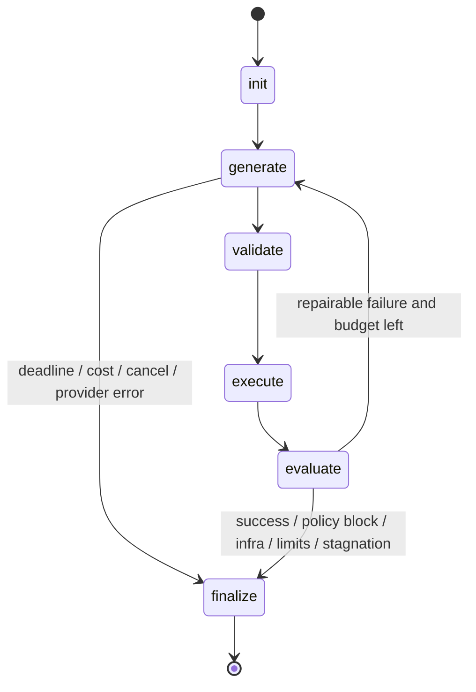
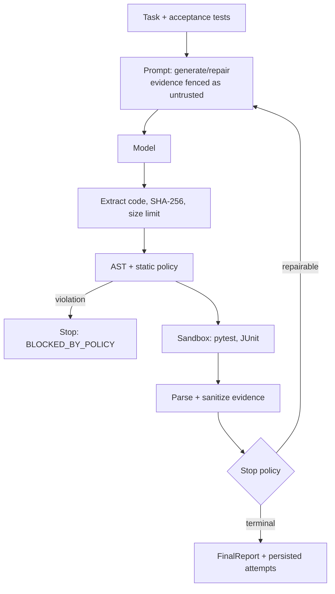

# Architecture

## Workflow state diagram

Loop bounds: attempt budget, deadline, cost check **before** each model call, repeated-artifact (SHA-256) and
AST-fingerprint stagnation detection, and a LangGraph recursion limit of `6*attempts+10`.

## Data flow

## Terminal states
SUCCESS, FAILED_VERIFICATION, BUDGET_EXHAUSTED, DEADLINE_EXCEEDED, BLOCKED_BY_POLICY, PROVIDER_ERROR, SANDBOX_ERROR,
CANCELLED; each carries a `TerminationReason`, the triggering policy, and limitations. Success requires syntax + static
checks + ≥1 passing test + 0 failures; a model's claim of success is never evidence.

## Technology choices and replaceability
| Tech | Why | Replace by |
|---|---|---|
| Pydantic v2 | validated domain models | dataclasses (loses validation) |
| LangGraph | explicit bounded graph | any state machine |
| SQLAlchemy + SQLite | simple persistence, PostgreSQL later | change `SAFELOOP_DB_URL` (+ migrations) |
| Docker SDK | process/FS/network isolation | any `Sandbox` impl (VM, gVisor) |
| FastAPI / Streamlit / Typer | API / ops UI / CLI over one service layer | any |
| Prometheus/Grafana/Loki | metrics / dashboards / logs | any OTLP-compatible stack |
